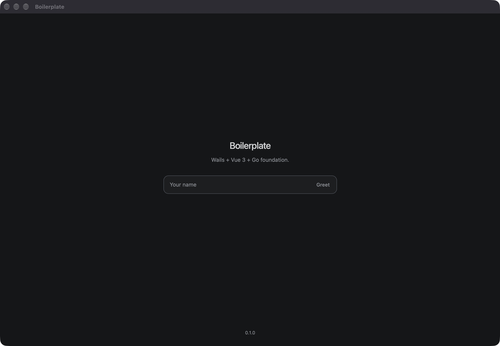
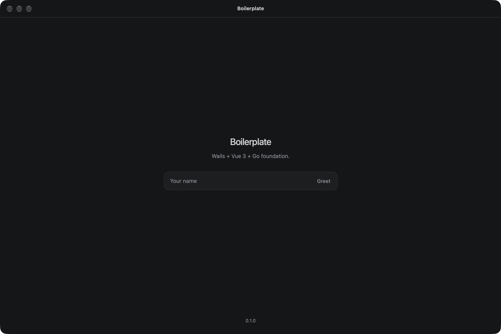

# Boilerplate

Wails v3 desktop app. Go backend, Vue 3 + TypeScript + Tailwind frontend.

**WindowFrameMenu** on macOS



**WindowFramelessMenu** on macOS



## Stack

- [Go](https://go.dev)
- [Wails v3](https://v3.wails.io)
- [Vue 3](https://vuejs.org) (`<script setup>`)
- [TypeScript](https://www.typescriptlang.org)
- [Vite](https://vite.dev)
- [Tailwind CSS v4](https://tailwindcss.com)
- [zerolog](https://github.com/rs/zerolog) (`prezerolog`), rotated logs in `internal/applog`

## Requirements

- Go 1.26+
- Node.js 24+ with npm
- Wails v3 CLI
- macOS 14+ to run the Mac app

### Wails CLI

```sh
go install github.com/wailsapp/wails/v3/cmd/wails3@v3.0.0
```

Binary: `$(go env GOPATH)/bin`.

```sh
export PATH="$PATH:$(go env GOPATH)/bin"
```

Check with `wails3 version`. The v2 `wails` binary is separate.

### Linux libraries

Debian/Ubuntu:

```sh
sudo apt install build-essential pkg-config libgtk-4-dev libwebkitgtk-6.0-dev
```

Fedora: `gtk4-devel`, `webkitgtk6.0-devel`. Arch: `gtk4`, `webkitgtk-6.0`.

## Build

Development:

```sh
wails3 dev
```

Build on macOS or Linux:

```sh
./scripts/build.sh build
```

Build on Windows, from PowerShell or Command Prompt:

```bat
scripts\build.cmd build
```

Release:

```sh
./scripts/build.sh build --dist
```

```bat
scripts\build.cmd build --dist
```

On Windows, `--dist` needs `signtool`, NSIS, and `build\dist.env`. Details: [Building and distributing](docs/building.md).

## Test

```sh
go test ./...
```

## Layout

- `main.go` - window bootstrap
- `app.go` - `Version`, `Greet`
- `config.go` - name, description, and version from `build/config.yml`
- `window.go` - window template
- `menu.go` - native menu
- `internal/applog` - process log
- `frontend/` - Vue app
- `Taskfile.yml` - Wails tasks
- `scripts/build.sh` - build and release. On Windows: `scripts\build.cmd`
- `docs/building.md` - packages and signing

## Window

`window` in `window.go`. Current value: `WindowFramelessMenu`.

| Constant | Result |
| --- | --- |
| `WindowFrame` | System frame. No menu. |
| `WindowFrameMenu` | System frame and native menu. |
| `WindowFramelessMenu` | Custom toolbar. macOS: native menu in the screen menu bar. Windows and Linux: minimise, maximise, and close in the toolbar. |
| `WindowFrameless` | Custom toolbar. No native menu. |

Frameless windows draw `frontend/src/Toolbar.vue`. macOS traffic lights are in that toolbar. On Windows and Linux the menu bar is part of the system frame, so `WindowFramelessMenu` and `WindowFrameless` both show the toolbar and no menu bar.

`menu.go`: macOS gets App, Edit, and Window. Windows and Linux get Edit and Window. On Windows the menu bar follows the system theme.

## Configuration

- `build/config.yml` `info.productName` - window title and UI heading
- `build/config.yml` `info.description` - app description and UI subtitle
- `build/config.yml` `info.version` - UI and About (`X.Y.Z`)
- `Taskfile.yml` `APP_NAME` - binary and package name
- `build/config.yml` `dev_mode.log_level` - Wails watcher
- `.env` `LOG_CONSOLE_LEVEL`, `LOG_FILE_LEVEL` - app log. Defaults are in `.env.sample`

`config.go` and the frontend load `productName`, `description`, and `version` from `build/config.yml`. `scripts/build.sh` reads `APP_NAME`, `info.productName`, and `info.version`.

`wails3 tool msix` reads `build/config.yml` when it packages. `build/windows/msix` is not an input.

## Rename

1. `build/config.yml`: `info.productName`, `info.description`, `info.companyName`, `info.version`, `info.productIdentifier`.
2. `APP_NAME` in `Taskfile.yml`.
3. `wails3 task common:update:build-assets`. Then set `LSMinimumSystemVersion` to `14.0.0` in `build/darwin/Info.plist` and `build/darwin/Info.dev.plist`. The task resets it to 12. It does not rewrite `build/windows/msix`.
4. Module path in `go.mod`, and `boilerplate/...` imports.

Icon: `build/appicon.png`.
