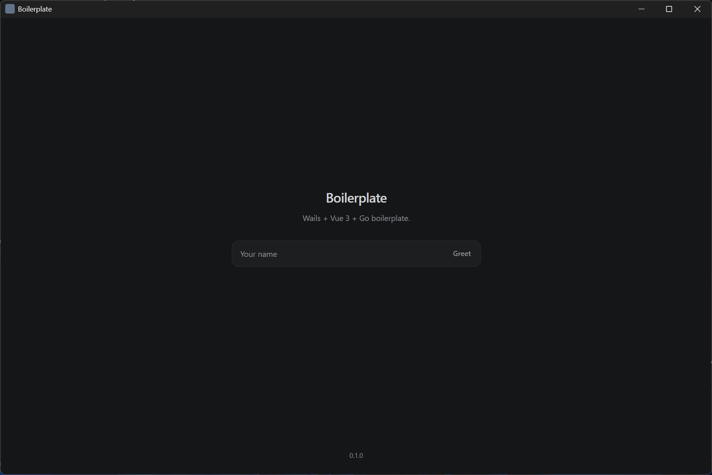
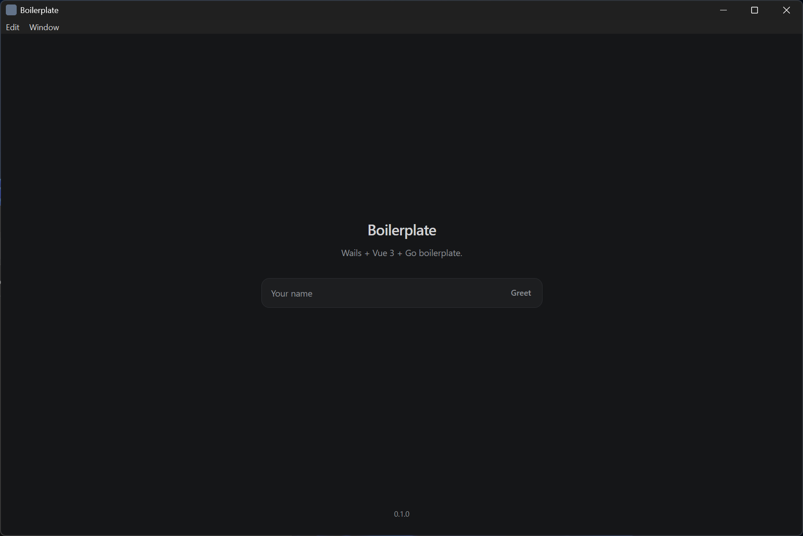
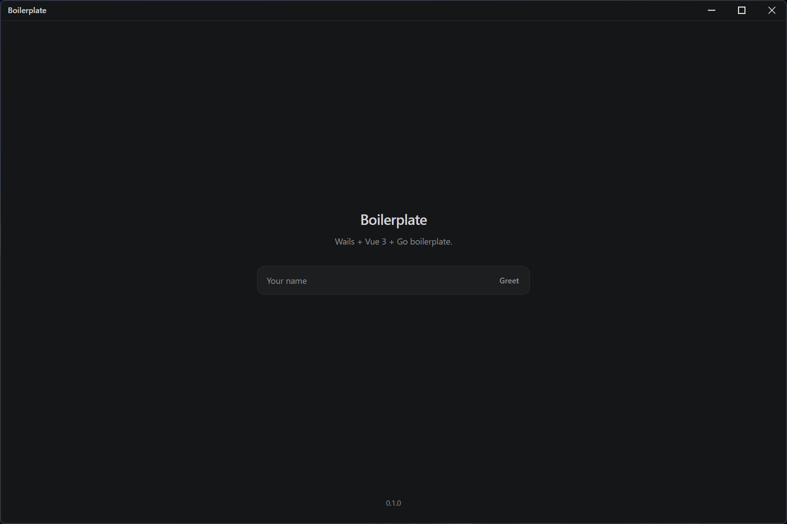
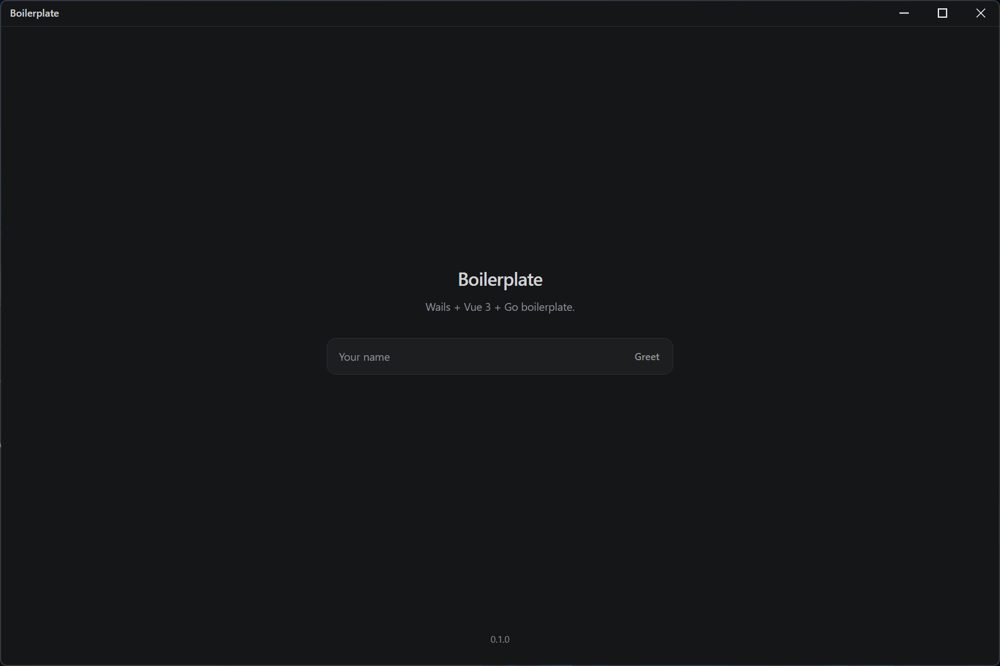

# Window modes

`window` in `window.go`. One picture per constant, on macOS, Windows, and Linux.

The README picture is **WindowFramelessMenu** on macOS: [`screenshot.png`](screenshot.png).

A heading with a path and no picture is waiting for that file. Save it under `docs/screenshots` with that name.

## macOS

The native menu is in the screen menu bar, outside the window. Frameless modes keep the macOS frame and hide its title bar. Traffic lights sit in `frontend/src/Toolbar.vue`.

### WindowFrame

System frame. No menu.

`screenshots/macos-WindowFrame.png`

### WindowFrameMenu

System frame. Native menu in the screen menu bar.

### WindowFramelessMenu

Custom toolbar. Native menu in the screen menu bar. This is the README picture.

### WindowFrameless

Custom toolbar. No native menu.

`screenshots/macos-WindowFrameless.png`

## Windows

The native menu hangs on the system frame. Frameless modes draw minimise, maximise, and close in the toolbar, and have no menu bar. `WindowFramelessMenu` and `WindowFrameless` look the same here.

### WindowFrame

System frame. No menu.

### WindowFrameMenu

System frame. Edit and Window menus.

### WindowFramelessMenu

Custom toolbar. No menu bar. Minimise, maximise, and close are in the toolbar.

### WindowFrameless

Custom toolbar. No menu.

## Linux

Same frame rules as Windows. The native menu is part of the system frame, so a frameless window has the toolbar and no menu bar.

### WindowFrame

System frame. No menu.

`screenshots/linux-WindowFrame.png`

### WindowFrameMenu

System frame. Edit and Window menus.

`screenshots/linux-WindowFrameMenu.png`

### WindowFramelessMenu

Custom toolbar. No menu bar. Minimise, maximise, and close are in the toolbar.

`screenshots/linux-WindowFramelessMenu.png`

### WindowFrameless

Custom toolbar. No menu.

`screenshots/linux-WindowFrameless.png`
